# 02. 사용자 흐름

> 다이어그램은 Mermaid로 썼다. GitHub, VS Code 미리보기, Notion에서 그림으로 보인다.
> 화면 ID(`P-xx`, `A-xx`)는 `03-screens.md`와 같다.

---

## 1. 전체 흐름

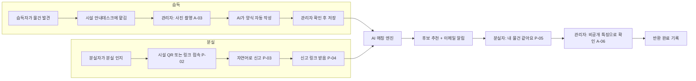

## 2. Flow A — 습득물 등록 (관리자)

목표: 사진 한 장으로 15초 안에 등록.

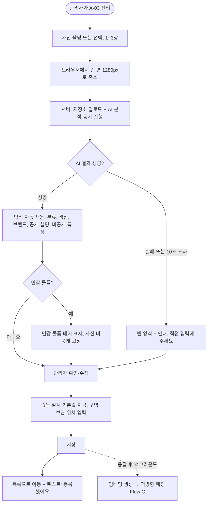

규칙
- 보관 위치는 직전에 입력한 값을 기본값으로 채운다 (연속 등록이 빠르도록).
- "저장 후 계속 등록" 버튼을 둔다.
- 민감 물품(신분증·카드)은 [민감 물품] 버튼으로 AI 분석 없이 등록한다. 사진을 외부 AI로 보내지 않는다.

### 2-1. 빠른 등록 모드 (연속 촬영)

하루 수십~100건이 들어오는 스키장용. 관리자 조작을 5초 안으로 줄인다.

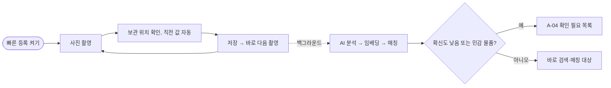

## 3. Flow B — 분실 신고 (분실자)

목표: 로그인 없이 60초 안에 신고.

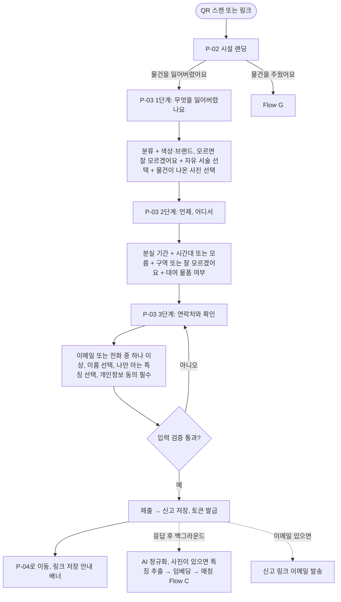

규칙
- 단계 이동 시 입력값을 유지한다 (뒤로 가기 해도 지워지지 않음).
- 모든 항목에 "잘 모르겠어요"를 둔다. 모른다고 답한 항목은 틀린 답으로 처리하지 않고 점수에서 뺀다.
- 분류나 설명 중 하나만 있어도 제출할 수 있다.
- 대여 물품이면 신고 완료 화면에 "빌린 곳(렌탈샵)에도 알려주세요" 안내를 보여준다.
- 3단계의 "나만 아는 특징"은 "케이스 안쪽 스티커, 이니셜처럼 남은 모르는 특징을 적어주세요. 관리자만 볼 수 있어요." 안내를 붙인다.

## 4. Flow C — 매칭 (시스템)

두 가지 계기로 실행된다: 신고 저장 직후, 습득물 저장 직후. 계산식은 `05-ai-matching.md`.

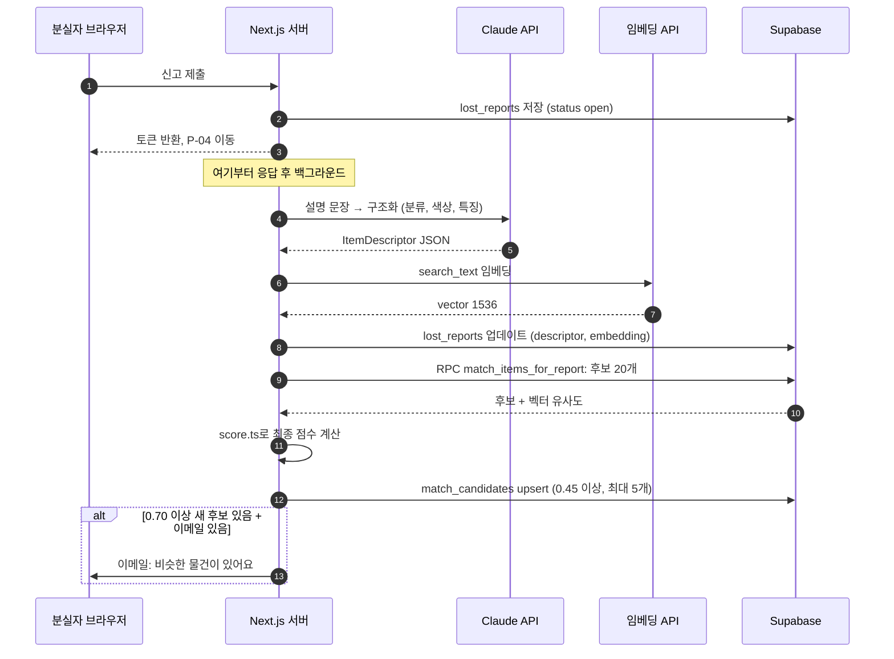

습득물 등록 시(역방향)도 같은 순서다. 차이: AI 분석은 등록 화면에서 이미 끝났으므로 임베딩부터 시작하고, RPC는 `match_reports_for_item`을 쓴다.

## 5. Flow D — 후보 확인과 소유권 확인 요청 (분실자)

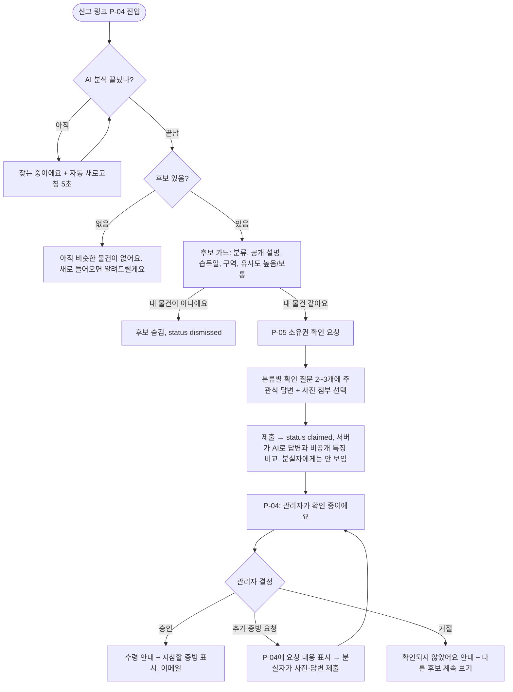

규칙
- 한 신고에서 동시에 진행 중인 소유권 확인 요청은 1개만 허용한다 (무작위 요청 방지).
- 같은 습득물에는 같은 신고로 최대 2번까지 요청할 수 있다.
- 정보 충족도가 낮은 후보는 "정보가 적어요" 표시와 함께 보여주고, 알림은 보내지 않는다. 분실자는 [신고 내용 보완하기]로 정보를 더할 수 있다.
- 확인 질문은 분류별로 고정이다. 질문만 보고 이 물건에 어떤 비공개 특징이 있는지 알 수 없어야 한다.
- 거절 사유는 분실자에게 자세히 보여주지 않는다 ("확인되지 않았어요. 궁금하면 시설로 문의해 주세요"). 비공개 특징이 새지 않게 하기 위해서다.

## 6. Flow E — 소유권 검토와 반환 (관리자)

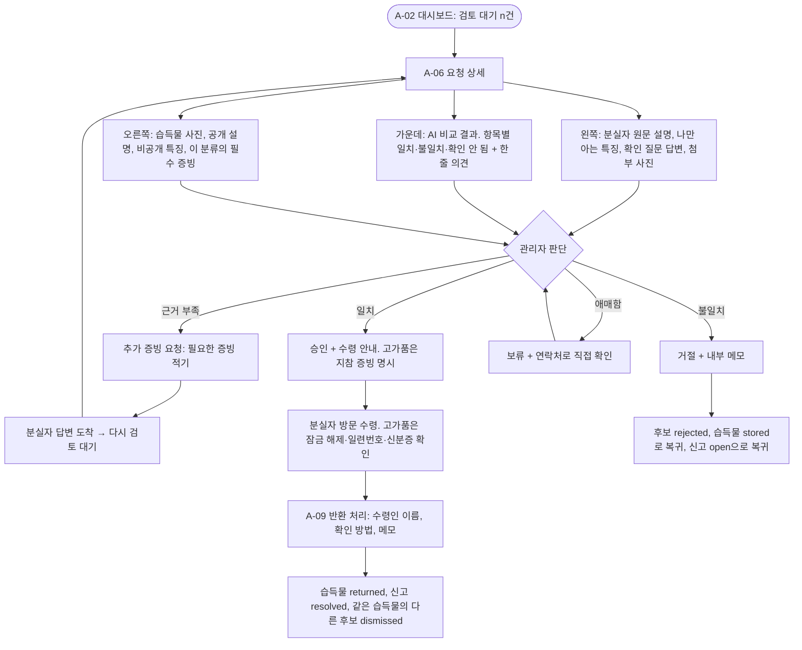

확인 방법 선택지: `신분증 확인`, `특징 문답`, `잠금 해제`, `일련번호`, `구매 내역`, `기타`.

규칙
- AI 비교 결과는 참고용이다. "일치"여도 승인을 자동으로 하지 않는다.
- AI 비교 결과와 비공개 특징은 분실자 화면, 이메일, 거절 안내 어디에도 나가지 않는다. 결과를 보여주면 여러 번 시도하며 답을 맞출 수 있기 때문이다.

## 7. Flow F — 전화·방문 문의 대응 (관리자)

관리자의 반복 문의 응대 시간을 줄이는 흐름. 스키장 인터뷰의 가장 큰 불편이다 (`01-prd.md` F9).

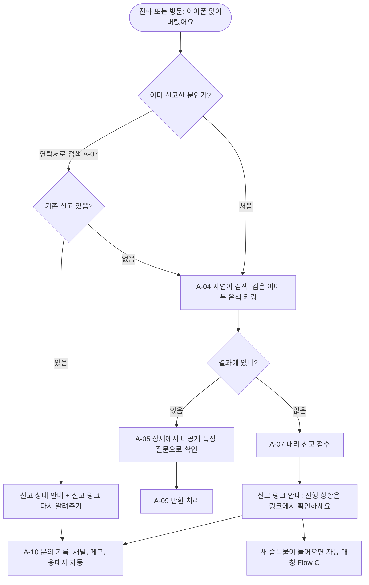

규칙
- 다른 직원이 이미 응대한 문의는 신고 상세의 문의 기록에 보인다. 같은 설명을 반복하지 않아도 된다.
- 응대가 끝나면 항상 신고 링크를 알려준다. 다음 문의를 셀프 조회로 돌리기 위해서다.

## 7-1. Flow F2 — 같은 분의 신고 묶기 (시스템)

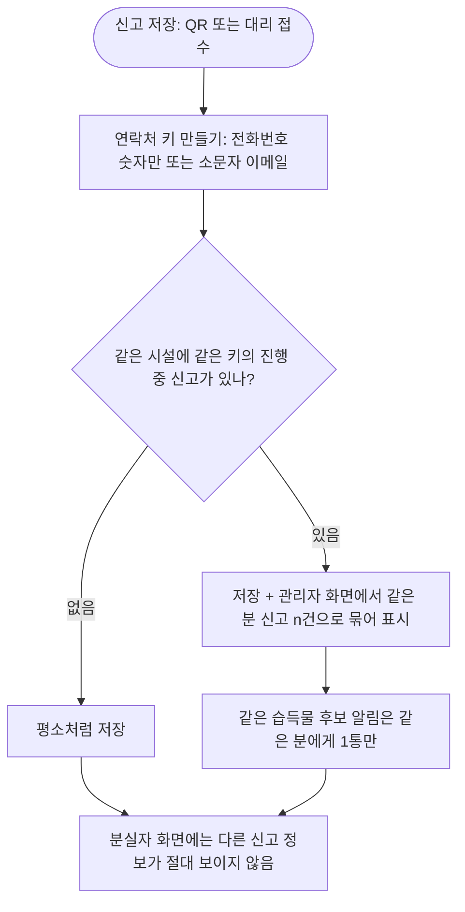

## 8. Flow G — 습득자

MVP에서는 안내만 한다. 습득자의 직접 등록은 P2.

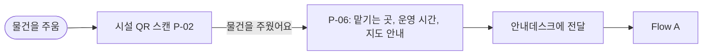

## 9. 상태 다이어그램

코드의 enum 값과 반드시 같아야 한다.

### 9-1. 습득물 `found_items.status`

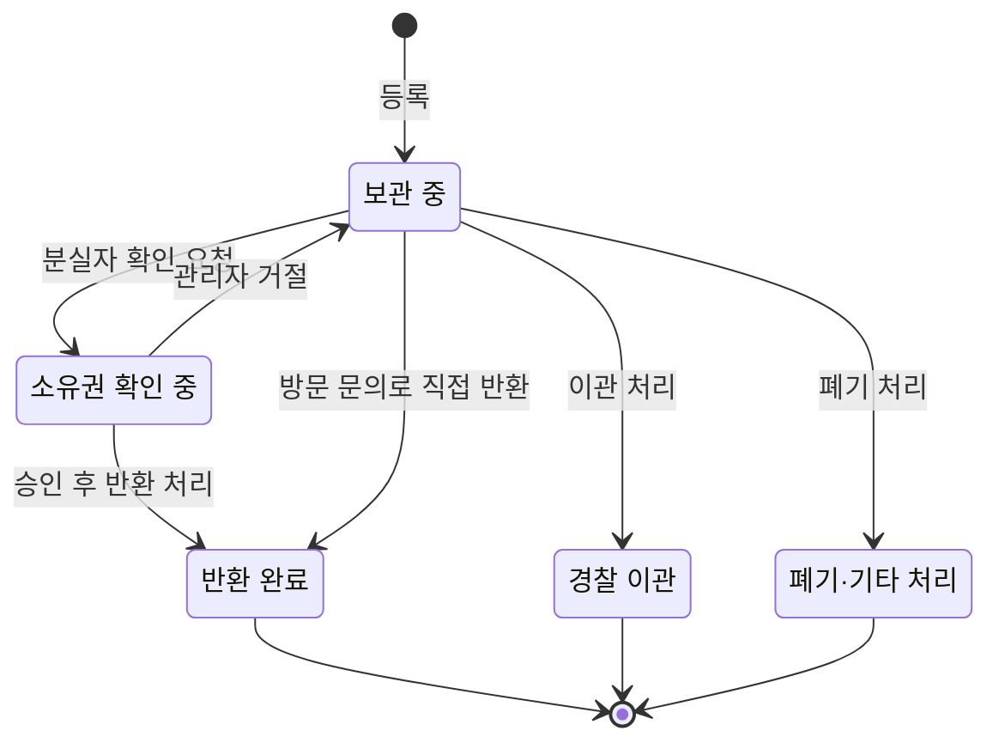

화면의 "매칭 후보 n건" 배지는 상태가 아니라 `match_candidates` 개수로 계산한다.

### 9-2. 분실 신고 `lost_reports.status`

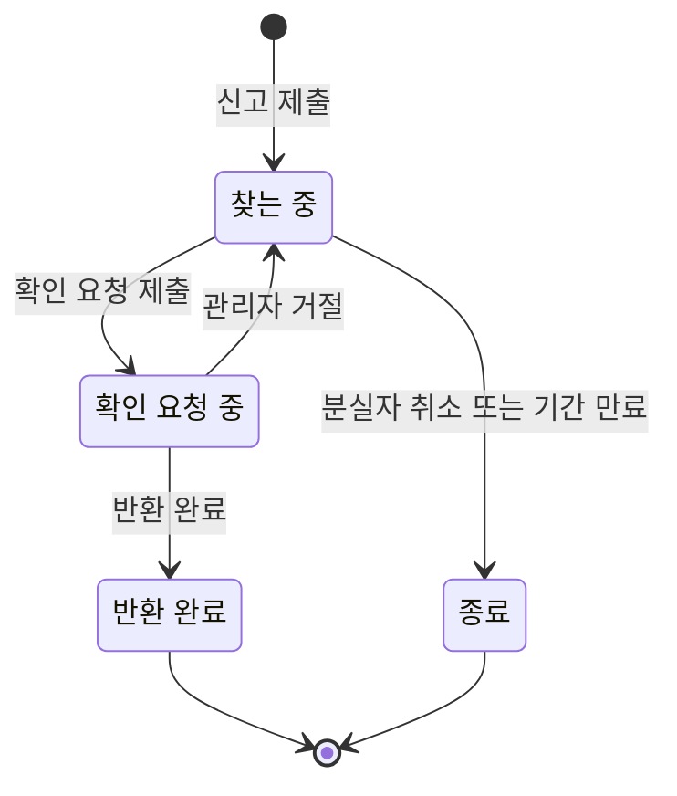

기간 만료(신고 후 30일, P1 자동화)는 `closed`로 바꾸고 연락처를 삭제한다.

### 9-3. 매칭 후보 `match_candidates.status`

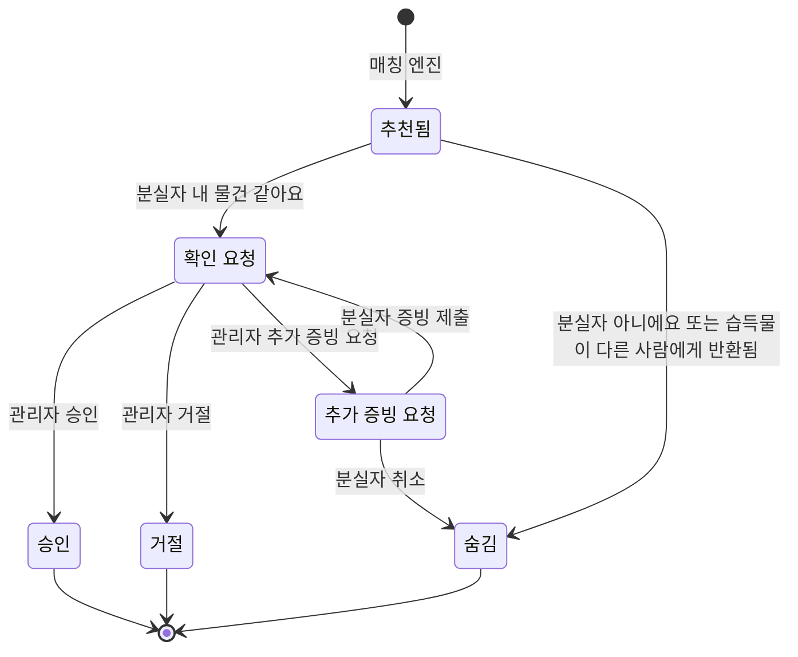

`dismissed` 사유는 `breakdown.dismiss_reason`에 남긴다: `user`, `item_returned`, `report_closed`.

## 10. 예외 케이스

| 상황 | 처리 |
|---|---|
| AI 분석 실패·시간 초과 (등록) | 빈 양식으로 수동 입력. 저장은 가능. 임베딩은 관리자가 입력한 텍스트로 만든다. |
| AI 분석 실패 (신고) | 원문 설명 그대로 임베딩해서 매칭. `ai_status = 'failed'`로 표시, 관리자 화면에 경고. |
| AI가 요청을 거부 (`stop_reason: refusal`) | 위와 같이 처리. 거부 사유는 로그에만 남긴다. |
| 신고 링크 분실 | MVP: 시설에 전화 → 관리자가 A-07에서 찾아 링크 재전달. P1: 이메일로 링크 재발송. |
| 같은 습득물에 여러 사람이 확인 요청 | 모두 받되 관리자 화면에 "다른 요청 n건" 경고. 하나를 승인하면 나머지는 자동 거절 대기. |
| 분실자가 물건을 다른 곳에서 찾음 | 신고 취소 버튼 → `closed`, 후보 모두 `dismissed`. |
| 신고는 왔는데 시설이 틀림 | MVP: 같은 시설만 매칭. P1: 같은 지역 시설까지 확장. |
| 민감 물품 (신분증 등) | 후보 카드에 분류만 표시 ("신분증·학생증"). 공개 설명에도 이름·번호 없음. |
| 습득 일시가 분실 기간보다 이전 | 매칭 후보에서 제외 (하루 오차 허용). |
| 보관 기한 임박 | 대시보드 할 일에 표시 (P1: 이메일 알림). |
| 같은 사람이 같은 물건을 두 번 신고 | 두 신고 모두 저장하고 관리자 화면에서 묶어 보여준다. 같은 습득물 알림은 1통만. |
| 다른 사람 전화번호로 신고 | 저장은 되지만 분실자 화면에는 그 번호의 다른 신고가 보이지 않는다. 관리자가 묶음을 보고 판단한다. |
| 흔한 물건이라 확인 근거가 없음 | AI 비교에 "판단 근거 부족" 표시. 관리자가 보류하거나 직접 확인한다. |
| 같은 사람이 여러 습득물에 계속 확인 요청 | 같은 습득물은 신고당 2번까지. 같은 연락처로 7일 안에 3건 이상이면 관리자 화면에 경고. |
| 같은 물건이 여러 개 (검은 장갑 3켤레) | 점수 차가 작으면 하나를 고르지 않고 모두 후보로 보여준다. 잃어버리기 전에 주운 것(시간대가 안 맞음)은 점수를 낮춘다. 구별은 소유권 확인에서 한다. |
| 분실자가 거의 기억하지 못함 | 분류·구역·날짜만으로 후보를 보여주되 "정보가 적어요" 표시. 반환 때는 추가 증빙이나 관리자 확인. |
| 대여한 장비를 잃어버림 | 신고는 받고 렌탈샵 안내를 함께 보여준다. 물건의 주인은 렌탈샵이다. |
| 관광객이 이미 집에 돌아감 | MVP는 방문 수령만. 수령 예약·대리 수령·착불 택배는 P1 (`01-prd.md` F10). |
