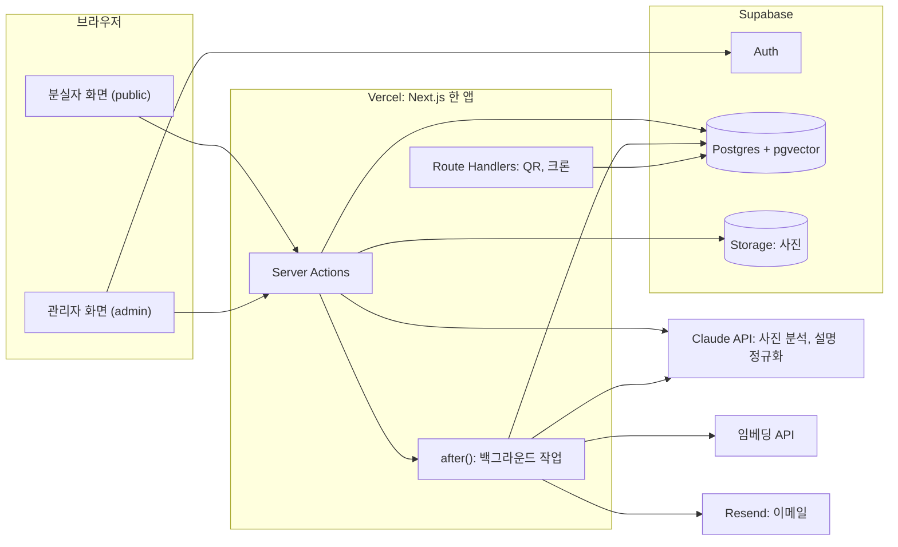
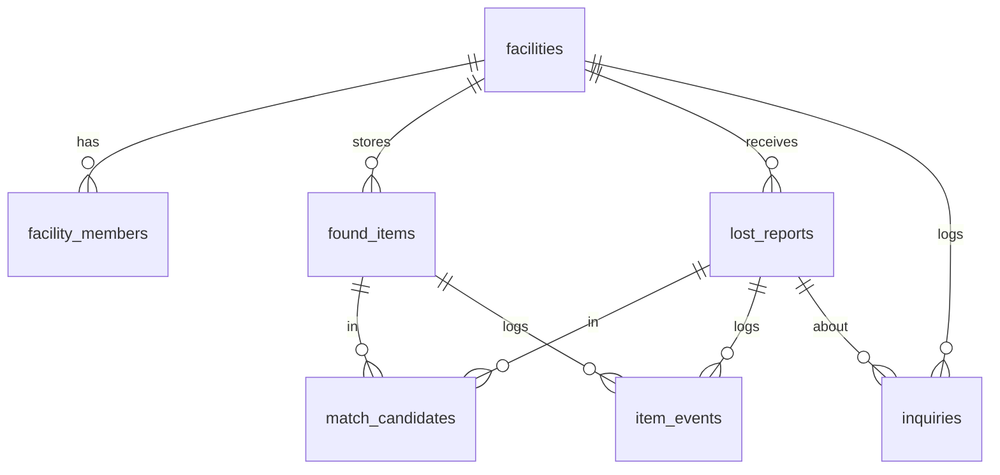

# 04. 시스템 구조

> 이 문서의 SQL은 첫 마이그레이션 초안이다. 실제 적용은 `supabase/migrations/`의 파일이 기준이며, 바꾸면 이 문서도 고친다.

---

## 1. 시스템 구성



원칙
- **한 앱, 두 화면 묶음.** `(public)`과 `admin` route group. 별도 백엔드 서버 없음.
- **서버만 DB에 쓴다.** 분실자 화면은 Server Action을 거쳐서만 데이터에 접근한다.
- **느린 일은 응답 뒤로.** 신고 정규화·임베딩·매칭·이메일은 `after()`로 응답 후에 실행한다. 사진 분석만 예외 (관리자가 결과를 기다려야 함).

## 2. 기술 선택 이유

| 선택 | 이유 | 버린 대안 |
|---|---|---|
| Next.js 한 앱 | 1인 개발, 배포·인증 공유, Server Action으로 API 코드 최소화 | 분실자용·관리자용 앱 분리 |
| Supabase | DB·인증·파일 저장·벡터 검색을 한 곳에서. 무료 요금제 | Firebase (벡터 검색 약함), 직접 구축 |
| pgvector | 스키장 기준 하루 최대 100건 × 1년 보관 = 시설당 연 수만 건. HNSW 인덱스로 충분하고 별도 벡터 DB 불필요 | Pinecone 등 |
| 모델 학습 없음 | 사진 → 구조화 텍스트 → 임베딩 비교로 MVP 충분 | 이미지 임베딩 모델 학습 |
| `after()` | 큐 없이 백그라운드 처리. MVP 규모에 충분 | 작업 큐 (Inngest, QStash) — Phase 1에서 재검토 |

## 3. 환경변수 (`.env.example`)

```bash
# Supabase
NEXT_PUBLIC_SUPABASE_URL=
NEXT_PUBLIC_SUPABASE_ANON_KEY=        # 새 프로젝트면 publishable key
SUPABASE_SERVICE_ROLE_KEY=            # 서버 전용. 브라우저 코드에서 절대 import 금지

# AI
ANTHROPIC_API_KEY=
VISION_MODEL=claude-opus-5-5
LLM_MODEL=claude-opus-5-5
OPENAI_API_KEY=                       # 임베딩용 (ADR-008)
EMBEDDING_MODEL=text-embedding-3-small
EMBEDDING_DIM=1536

# 매칭
MATCH_SAVE_THRESHOLD=0.45
MATCH_NOTIFY_THRESHOLD=0.70

# 이메일
RESEND_API_KEY=
EMAIL_FROM=

# 앱
NEXT_PUBLIC_APP_URL=http://localhost:3000
```

## 4. 데이터베이스

### 4-1. 관계도



### 4-2. 스키마 (마이그레이션 `0001_init.sql` 초안)

```sql
-- 확장
create extension if not exists vector with schema extensions;

-- enum: docs/02-user-flows.md §9 와 같아야 한다
create type facility_type    as enum ('school','ski_resort','hotel','festival','cafe','other');
create type member_role      as enum ('owner','staff');
create type found_status     as enum ('stored','claimed','returned','transferred','disposed');
create type report_status    as enum ('open','claimed','resolved','closed');
create type candidate_status as enum ('suggested','claimed','needs_proof','approved','rejected','dismissed');
create type ai_status        as enum ('pending','done','failed','skipped');
create type inquiry_channel  as enum ('phone','visit','message','other');

-- 시설
create table facilities (
  id             uuid primary key default gen_random_uuid(),
  name           text not null,
  slug           text not null unique,            -- QR 주소 /f/{slug}
  type           facility_type not null default 'other',
  region         text,                            -- '평창', '서울 노원' (P1 지역 검색)
  areas          text[] not null default '{}',    -- 구역 목록
  contact_phone  text,
  hours          text,                            -- 운영 시간 안내
  desk_location  text,                            -- 맡기는 곳 안내 (P-06)
  pickup_guide   text,                            -- 수령 안내 문구 (승인 시 표시)
  transfer_days  int  not null default 30,        -- 보관 기한. 인터뷰: 학교 1~6주, 스키장 1년 → 스키장은 365로 생성. 법정 기한 확인 필요 (Q2, ADR-018)
  created_at     timestamptz not null default now()
);

create table facility_members (
  facility_id uuid not null references facilities(id) on delete cascade,
  user_id     uuid not null references auth.users(id) on delete cascade,
  role        member_role not null default 'staff',
  primary key (facility_id, user_id)
);

-- 습득물
create table found_items (
  id                  uuid primary key default gen_random_uuid(),
  facility_id         uuid not null references facilities(id) on delete cascade,
  status              found_status not null default 'stored',

  -- 물품 정보 (AI가 채우고 관리자가 확인)
  category            text not null,               -- 05-ai-matching.md §2 분류 코드
  subcategory         text,
  colors              text[] not null default '{}',
  brand               text,
  material            text,
  features            text[] not null default '{}', -- 공개 가능한 특징
  public_summary      text not null,                -- 분실자에게 보이는 설명
  private_features    text[] not null default '{}', -- 비공개 식별 특징 (소유권 확인용)
  is_sensitive        boolean not null default false,
  review_needed       boolean not null default false, -- 빠른 등록에서 AI 확신도 낮음·민감 물품 → 확인 필요
  search_text         text,                         -- 임베딩 입력 (코드에서 생성)
  embedding           vector(1536),

  -- 습득·보관
  photo_paths         text[] not null default '{}',
  found_at            timestamptz not null,
  found_area          text,
  storage_location    text,
  transfer_due_at     timestamptz,                  -- found_at + transfer_days

  -- AI 기록
  ai_status           ai_status not null default 'pending',
  ai_confidence       numeric(3,2),
  ai_model            text,
  ai_latency_ms       int,
  ai_raw              jsonb,                        -- 원본 응답 + usage (평가·디버깅)

  -- 반환 기록
  returned_at         timestamptz,
  returned_to_name    text,
  return_method       text,                         -- id_check | qa | unlock | serial | receipt | other
  return_note         text,

  -- 지표
  register_started_at timestamptz,                  -- 등록 화면 진입 시각

  created_by          uuid references auth.users(id),
  created_at          timestamptz not null default now(),
  updated_at          timestamptz not null default now()
);
create index found_items_facility_idx on found_items (facility_id, status, found_at desc);
create index found_items_embedding_idx on found_items using hnsw (embedding vector_cosine_ops);

-- 분실 신고
create table lost_reports (
  id                uuid primary key default gen_random_uuid(),
  facility_id       uuid not null references facilities(id) on delete cascade,
  status            report_status not null default 'open',

  description       text not null,                 -- 분실자 원문
  secret_detail     text,                          -- 나만 아는 특징 (관리자만 봄)
  user_category     text,                          -- 분실자가 고른 분류 (선택)
  language          text not null default 'ko',

  -- AI 정규화 결과
  category          text,
  subcategory       text,
  colors            text[] not null default '{}',
  brand             text,
  features          text[] not null default '{}',
  search_text       text,
  embedding         vector(1536),
  ai_status         ai_status not null default 'pending',
  ai_confidence     numeric(3,2),
  ai_raw            jsonb,

  -- 언제·어디서 (날짜는 한국 시간 기준)
  lost_from         date not null,
  lost_to           date not null,
  lost_area         text,                          -- null = 잘 모르겠어요
  lost_time_of_day  text,                          -- morning | lunch | afternoon | evening | null(모름)
  is_rental         boolean not null default false, -- 빌린 물건 (렌탈 장비)
  report_photo_paths text[] not null default '{}',  -- 분실자가 올린 물건이 나온 사진 (보조 근거, 종료 30일 후 삭제)

  -- 연락처 (LLM에 보내지 않음, 종료 30일 후 삭제)
  contact_name      text,
  contact_email     text,
  contact_phone     text,
  contact_key       text,                          -- 같은 분 묶기: 전화번호 숫자만 또는 소문자 이메일 (F9-1). 분실자 응답에 절대 포함 금지
  consent_at        timestamptz not null,

  access_token      text not null unique,          -- 앱에서 생성: randomBytes(24) base64url
  created_via       text not null default 'qr',    -- qr | admin
  created_by        uuid references auth.users(id),
  report_started_at timestamptz,                   -- 신고 화면 진입 시각
  closed_at         timestamptz,
  created_at        timestamptz not null default now(),

  constraint lost_range_chk check (lost_from <= lost_to),
  constraint contact_chk    check (contact_email is not null or contact_phone is not null)
);
create index lost_reports_facility_idx on lost_reports (facility_id, status, created_at desc);
create index lost_reports_embedding_idx on lost_reports using hnsw (embedding vector_cosine_ops);
create index lost_reports_contact_idx on lost_reports (facility_id, contact_key) where contact_key is not null;

-- 매칭 후보 (+ 소유권 확인 요청)
create table match_candidates (
  id                uuid primary key default gen_random_uuid(),
  facility_id       uuid not null references facilities(id) on delete cascade,  -- RLS 단순화용
  lost_report_id    uuid not null references lost_reports(id) on delete cascade,
  found_item_id     uuid not null references found_items(id) on delete cascade,
  score             numeric(5,4) not null,             -- 비교한 항목만으로 낸 일치도
  coverage          numeric(4,3) not null default 1,   -- 정보 충족도: 비교에 쓴 신호의 가중치 합 (05 §5)
  breakdown         jsonb not null,     -- {feature, place, date, vec, attr, known[], tie?, dismiss_reason?}
  status            candidate_status not null default 'suggested',

  claim_answers     jsonb,              -- [{question_id, question, answer}] 분류별 확인 질문 답변
  claim_photo_path  text,
  claim_attempt     int not null default 0,  -- 같은 신고·습득물 쌍의 요청 횟수 (최대 2)
  ai_verdict        jsonb,              -- AI 답변 비교 결과 (05-ai-matching.md §9-2). 관리자 전용
  proof_request     text,               -- 관리자가 요청한 추가 증빙 (분실자에게 보임)
  proof_reply       text,
  proof_photo_path  text,
  claimed_at        timestamptz,
  reviewed_by       uuid references auth.users(id),
  reviewed_at       timestamptz,
  review_note       text,               -- 내부 메모 (분실자에게 안 보임)
  pickup_message    text,               -- 승인 시 분실자에게 보낼 수령 안내

  notified_at       timestamptz,
  created_at        timestamptz not null default now(),
  updated_at        timestamptz not null default now(),
  unique (lost_report_id, found_item_id)
);
-- 한 신고에서 진행 중인 확인 요청은 1개만
create unique index one_active_claim_per_report
  on match_candidates (lost_report_id) where status = 'claimed';

-- 문의 기록 (반복 문의 줄이기, F9-2)
create table inquiries (
  id              uuid primary key default gen_random_uuid(),
  facility_id     uuid not null references facilities(id) on delete cascade,
  lost_report_id  uuid references lost_reports(id) on delete set null,
  channel         inquiry_channel not null default 'phone',
  contact_key     text,              -- 신고를 연결하지 않았을 때 같은 분을 묶는 키
  note            text,
  handled_by      uuid references auth.users(id),
  created_at      timestamptz not null default now()
);
create index inquiries_facility_idx on inquiries (facility_id, created_at desc);
create index inquiries_report_idx on inquiries (lost_report_id);
create index inquiries_contact_idx on inquiries (facility_id, contact_key) where contact_key is not null;

-- 처리 이력 (감사 로그)
create table item_events (
  id              bigint generated always as identity primary key,
  facility_id     uuid not null references facilities(id) on delete cascade,
  found_item_id   uuid references found_items(id) on delete cascade,
  lost_report_id  uuid references lost_reports(id) on delete cascade,
  actor           uuid references auth.users(id),   -- null = 분실자 또는 시스템
  type            text not null,
  -- registered | ai_extracted | edited | matched | notified | claimed
  -- | approved | rejected | returned | transferred | disposed | report_created | report_closed | inquiry_logged
  payload         jsonb not null default '{}',
  created_at      timestamptz not null default now()
);
create index item_events_item_idx on item_events (found_item_id, created_at);
```

### 4-3. 매칭·검색 함수

날짜 비교는 모두 한국 시간(`Asia/Seoul`) 기준이다.

```sql
-- 신고 → 습득물 후보
create or replace function match_items_for_report(p_report_id uuid, p_limit int default 20)
returns table (
  found_item_id uuid, vec_sim float8, found_date date, found_area text,
  category text, colors text[], brand text, ai_confidence numeric
)
language sql stable as $$
  select fi.id,
         1 - (fi.embedding <=> lr.embedding),
         (fi.found_at at time zone 'Asia/Seoul')::date,
         fi.found_area, fi.category, fi.colors, fi.brand, fi.ai_confidence
  from lost_reports lr
  join found_items fi on fi.facility_id = lr.facility_id
  where lr.id = p_report_id
    and lr.embedding is not null
    and fi.embedding is not null
    and fi.status in ('stored','claimed')
    and (fi.found_at at time zone 'Asia/Seoul')::date
        between lr.lost_from - 1 and lr.lost_to + 14
  order by fi.embedding <=> lr.embedding
  limit p_limit;
$$;

-- 습득물 → 신고 후보 (역방향)
create or replace function match_reports_for_item(p_item_id uuid, p_limit int default 20)
returns table (
  lost_report_id uuid, vec_sim float8, lost_from date, lost_to date, lost_area text,
  category text, colors text[], brand text, ai_confidence numeric
)
language sql stable as $$
  select lr.id,
         1 - (lr.embedding <=> fi.embedding),
         lr.lost_from, lr.lost_to, lr.lost_area,
         lr.category, lr.colors, lr.brand, lr.ai_confidence
  from found_items fi
  join lost_reports lr on lr.facility_id = fi.facility_id
  where fi.id = p_item_id
    and fi.embedding is not null
    and lr.embedding is not null
    and lr.status in ('open','claimed')
    and (fi.found_at at time zone 'Asia/Seoul')::date
        between lr.lost_from - 1 and lr.lost_to + 14
  order by lr.embedding <=> fi.embedding
  limit p_limit;
$$;

-- 관리자 자연어 검색 (security invoker → RLS 적용)
create or replace function search_items(p_query vector(1536), p_limit int default 20)
returns setof found_items
language sql stable as $$
  select * from found_items
  where embedding is not null
  order by embedding <=> p_query
  limit p_limit;
$$;
```

## 5. 권한 (RLS)과 저장소

### 5-1. RLS

```sql
create or replace function is_facility_member(fid uuid)
returns boolean
language sql stable security definer set search_path = public as $$
  select exists (
    select 1 from facility_members m
    where m.facility_id = fid and m.user_id = auth.uid()
  );
$$;

alter table facilities       enable row level security;
alter table facility_members enable row level security;
alter table found_items      enable row level security;
alter table lost_reports     enable row level security;
alter table match_candidates enable row level security;
alter table item_events      enable row level security;
alter table inquiries        enable row level security;

create policy fac_select   on facilities       for select using (is_facility_member(id));
create policy fac_update   on facilities       for update using (
  exists (select 1 from facility_members m
          where m.facility_id = id and m.user_id = auth.uid() and m.role = 'owner'));
create policy mem_select   on facility_members for select using (user_id = auth.uid());
create policy items_all    on found_items      for all
  using (is_facility_member(facility_id)) with check (is_facility_member(facility_id));
create policy reports_all  on lost_reports     for all
  using (is_facility_member(facility_id)) with check (is_facility_member(facility_id));
create policy cand_all     on match_candidates for all
  using (is_facility_member(facility_id)) with check (is_facility_member(facility_id));
create policy events_sel   on item_events      for select using (is_facility_member(facility_id));
create policy events_ins   on item_events      for insert with check (is_facility_member(facility_id));
create policy inq_all      on inquiries        for all
  using (is_facility_member(facility_id)) with check (is_facility_member(facility_id));
```

- anon 역할에는 정책이 없다 → 분실자 브라우저는 테이블에 직접 접근할 수 없다.
- 분실자 관련 처리(신고 저장, 토큰 조회, 확인 요청)와 백그라운드 매칭은 **service role**로 서버에서 실행한다. service role은 RLS를 우회하므로, 이 코드는 반드시 `facility_id` 또는 `access_token`으로 범위를 직접 제한한다.
- 관리자 처리는 로그인한 사용자의 Supabase 클라이언트로 실행해 RLS를 그대로 받는다.

### 5-2. Storage

| 버킷 | 공개 | 경로 | 쓰기 | 읽기 |
|---|---|---|---|---|
| `found-items` | 비공개 | `{facility_id}/{uuid}.jpg` | 서버 (Server Action) | 관리자: 10분 만료 서명 URL |
| `claim-photos` | 비공개 | `{facility_id}/{candidate_id}/{uuid}.jpg` | 서버 (service role) | 관리자: 10분 만료 서명 URL |
| `report-photos` | 비공개 | `{facility_id}/{report_id}/{uuid}.jpg` | 서버 (service role) | 관리자: 10분 만료 서명 URL. 종료 30일 후 삭제 |

Storage 정책: `found-items`는 `(storage.foldername(name))[1]::uuid`가 내 시설인 경우만 읽기 허용. 분실자에게는 어떤 사진 URL도 내려보내지 않는다.

## 6. Server Actions

> 위치: `src/server/actions/*.ts`. 모든 입력은 zod로 검증. 반환 형식 `{ ok: true, data } | { ok: false, error: string }`.

### 6-1. 습득물 (`items.ts`, 관리자)

| 함수 | 입력 | 처리 | 출력 |
|---|---|---|---|
| `analyzePhoto` | `FormData` (사진 1~3장, 각 5MB 이하) | 업로드와 AI 분석을 `Promise.all`로 동시 실행. AI 실패 시 `extraction: null` | `{ photoPaths, extraction, aiLatencyMs }` |
| `createFoundItem` | 양식 값 + `photoPaths` + `extraction` 원본 + `registerStartedAt` | 저장, `transfer_due_at` 계산, 이벤트 `registered`. `after()`로 임베딩 → 역방향 매칭 | `{ id }` |
| `quickCreateFoundItem` | 사진 + 보관 위치 + `registerStartedAt` | 바로 저장(`ai_status = pending`). `after()`로 AI 분석 → 필드 채움 → 확신도 0.6 미만이나 민감 물품이면 `review_needed = true` → 임베딩 → 매칭 | `{ id }` |
| `createSensitiveItem` | 분류 + 사진 + 보관 위치 | AI 분석 없이 저장 (`ai_status = skipped`, `is_sensitive = true`). 사진은 외부 AI로 보내지 않는다 | `{ id }` |
| `updateFoundItem` | `id` + 바뀐 필드 | 특징 관련 필드가 바뀌면 `after()`로 재임베딩·재매칭. 이벤트 `edited` | `{ id }` |
| `setFoundItemStatus` | `id`, `transferred` \| `disposed`, 메모 | 상태 변경, 관련 후보 `dismissed`, 이벤트 | `{ id }` |
| `markReturned` | `id`, `candidateId?`, 수령인, 확인 방법, 메모 | 습득물 `returned`, 후보 `approved` 유지, 신고 `resolved`, 같은 습득물의 다른 후보 `dismissed (item_returned)`, 이벤트 `returned` — 한 트랜잭션 (RPC) | `{ id }` |
| `searchItems` | `query` 문자열 | 질의 임베딩 → `search_items` RPC | 습득물 목록 |
| `retryAnalysis` | `id` | `ai_status = failed`인 습득물·신고 재처리 | `{ id }` |

### 6-2. 분실 신고 (`reports.ts`)

| 함수 | 사용자 | 처리 | 출력 |
|---|---|---|---|
| `createLostReport` | 분실자 (비로그인) | slug로 시설 확인, 토큰 생성, `contact_key` 계산, 저장, 이벤트. `after()`로 정규화(사진이 있으면 특징 추출 후 합침) → 임베딩 → 매칭 → 이메일 | `{ token }` |
| `createReportByAdmin` | 관리자 | `created_via = 'admin'`, 이후 같음 | `{ token }` |
| `getReportView` | 분실자 | 토큰으로 조회. **공개 필드만** 골라 반환 (§9-2) | 신고 요약 + 후보 공개 정보 |
| `cancelReport` | 분실자 | `closed`, 후보 `dismissed (report_closed)` | `{ ok }` |
| `updateLostReport` | 분실자 | 토큰 확인 후 설명·색상·브랜드·시간대·사진 보완 → 다시 정규화·매칭 | `{ ok }` |

### 6-3. 후보·소유권 확인 (`candidates.ts`)

| 함수 | 사용자 | 처리 |
|---|---|---|
| `dismissCandidate` | 분실자 | 토큰 소유 확인 후 `dismissed (user)` |
| `submitClaim` | 분실자 | 토큰 소유 확인, 진행 중 요청 없음·시도 2회 미만 확인, 분류별 질문 답변·사진 저장, 후보 `claimed`, 습득물 `claimed`, 신고 `claimed`. `after()`로 AI 답변 비교 → `ai_verdict` 저장 |
| `reviewClaim` | 관리자 | `approve`: 후보 `approved`, 수령 안내(필수 증빙 포함) 저장·이메일. `request_proof`: 후보 `needs_proof`, `proof_request` 저장, 분실자 이메일. `hold`: 상태 유지, 내부 메모. `reject`: 후보 `rejected`, 습득물에 다른 `claimed` 후보가 없으면 `stored`, 신고 `open` |
| `submitProof` | 분실자 | 토큰 소유 확인, 후보가 `needs_proof`일 때만 답변·사진 저장 → `claimed`로 복귀, AI 비교 다시 실행 |

### 6-4. Route Handlers

| 경로 | 용도 |
|---|---|
| `GET /api/qr/[slug]` | QR PNG 생성 (`qrcode` 패키지) |
| `GET /api/cron/cleanup` | (P1) 종료 30일 지난 신고의 연락처 삭제. Vercel Cron |

### 6-5. 문의 (`inquiries.ts`, 관리자)

| 함수 | 입력 | 처리 | 출력 |
|---|---|---|---|
| `findReportsByContact` | 전화번호 뒷자리 4개 또는 이메일 | 같은 시설 신고를 연락처로 검색, 같은 `contact_key`끼리 묶어 반환 | 신고 묶음 목록 |
| `logInquiry` | `channel`, `lostReportId?`, `contact?`, `note?` | 문의 기록 저장 (`handled_by` = 로그인 사용자), 이벤트 `inquiry_logged` | `{ id }` |
| `listInquiries` | `lostReportId` 또는 `contactKey` | 시간순 문의 기록 | 문의 목록 |

`contact_key` 만드는 규칙 (`lib/validation/contact.ts`의 `toContactKey`): 전화번호는 숫자만 남기고 앞의 `82`를 `0`으로, 이메일은 앞뒤 공백을 빼고 소문자로. 단위 테스트 필수.

## 7. 백그라운드 작업

```ts
// 예: createLostReport 안
import { after } from 'next/server';

const report = await insertReport(input);      // service role
after(async () => {
  await processReport(report.id);              // 정규화 → 임베딩 → 매칭 → 알림
});
return { ok: true, data: { token: report.access_token } };
```

- `processReport` / `processItem`은 각 단계 실패 시 `ai_status = 'failed'`로 표시하고 원문으로 계속 진행한다 (`02-user-flows.md` §10).
- 같은 작업이 두 번 돌아도 결과가 같게 만든다: 후보는 `(lost_report_id, found_item_id)` upsert, `claimed` 이후 상태는 덮어쓰지 않는다.
- 해당 경로의 `maxDuration`은 60초로 둔다.

## 8. 알림 (이메일)

| 계기 | 받는 사람 | 제목 |
|---|---|---|
| 신고 접수 | 분실자 | [잇츠미] 신고했어요 — 신고 확인 링크 |
| 0.70 이상 새 후보 | 분실자 | [잇츠미] 비슷한 물건이 들어왔어요 |
| 소유권 승인 | 분실자 | [잇츠미] 주인 확인이 끝났어요 — 수령 안내 |
| 새 확인 요청 | 시설 관리자 | [잇츠미] 새 확인 요청 1건 (P1) |

- 신고 1건당 후보 알림은 24시간에 최대 3통 (`notified_at`으로 계산).
- 같은 `contact_key`의 여러 신고가 같은 습득물과 매칭되면 알림은 1통만 보낸다.
- 이메일 본문에는 공개 설명만 넣는다. 사진·비공개 특징·점수는 넣지 않는다.

## 9. 보안과 개인정보

### 9-1. 체크리스트

- [ ] service role 키는 `lib/supabase/admin.ts`에서만, `server-only`로 보호
- [ ] 분실자 토큰: 24바이트 난수, URL에만 존재. 로그에 남기지 않는다
- [ ] 사진은 비공개 버킷 + 서명 URL (10분)
- [ ] 업로드 검증: 이미지 MIME만, 장당 5MB 이하, 최대 3장
- [ ] 분실자 쓰기 요청에 숨은 입력칸(honeypot) 추가. 요청 수 제한은 P1
- [ ] 소유권 확인 요청 시도 제한: 신고당 동시 1건, 같은 신고·습득물 쌍 2회, 같은 연락처 7일 3건 이상 경고
- [ ] LLM에 연락처 전송 금지. 사진 속 개인정보는 프롬프트로 마스킹 지시
- [ ] 민감 물품 버튼으로 등록한 사진은 외부 AI로 보내지 않는다
- [ ] 분실자가 올린 사진(얼굴이 나올 수 있음)은 비공개 버킷에 두고, 종료 30일 후 삭제
- [ ] 동의 문구에 수집 항목, 목적, 보관 기간 명시
- [ ] 종료 30일 후 연락처와 `contact_key` 삭제 (MVP 수동, P1 크론). 연결된 문의 기록의 `contact_key`도 함께

### 9-2. 분실자에게 내려보내도 되는 필드 (허용 목록)

| 테이블 | 허용 필드 |
|---|---|
| `lost_reports` | `description`, `lost_from`, `lost_to`, `lost_area`, `lost_time_of_day`, `is_rental`, `status`, `created_at`, `ai_status` |
| `match_candidates` | `id`, `status`, 유사도 라벨(높음/보통 — 점수 숫자 아님), 정보 부족 표시(충족도 숫자 아님), `pickup_message`(승인 시), `proof_request`(추가 증빙 요청 시). **`ai_verdict`, `review_note`는 절대 안 됨** |
| `found_items` | `category`, `subcategory`, `public_summary`, 습득 날짜(일 단위), `found_area`. **민감 물품이면 `category`만** |
| `facilities` | `name`, `contact_phone`, `hours`, `desk_location`, `pickup_guide` |

이 목록 밖의 필드를 분실자 응답에 넣는 코드는 리뷰에서 막는다. 특히 `contact_key`와 같은 연락처의 다른 신고가 있는지 여부는 절대 넣지 않는다 (F9 개인정보 규칙). `getReportView`에 이 목록을 그대로 코드로 둔다.

## 10. 관측과 지표 수집

| 지표 | 저장 위치 |
|---|---|
| 등록 소요시간 | `found_items.created_at - register_started_at` |
| 신고 소요시간 | `lost_reports.created_at - report_started_at` |
| AI 지연·토큰 사용량 | `found_items.ai_latency_ms`, `ai_raw.usage` / `lost_reports.ai_raw.usage` |
| 매칭 결과 | `match_candidates.breakdown` |
| 처리 흐름 | `item_events` |
| 문의 수, 같은 분 재문의 수 | `inquiries` (날짜별, `contact_key`별) |

서버 로그: AI 호출마다 `{ kind, model, latency_ms, input_tokens, output_tokens, stop_reason }` 한 줄. 연락처·토큰은 로그에 남기지 않는다.

## 11. 배포

- Vercel 프로젝트 1개, `main` 브랜치 자동 배포, PR마다 미리보기 배포.
- Supabase 프로젝트 1개 (MVP). Phase 1에서 개발/운영 분리.
- 시드: `pnpm db:seed` — 시설 2개(인덕대 데모 `transfer_days` 30, 스키장 데모 365), 관리자 계정 1개, 구역 목록.
- 리전: Supabase는 서울(`ap-northeast-2`), Vercel 함수 리전도 서울(`icn1`)로 맞춘다.
