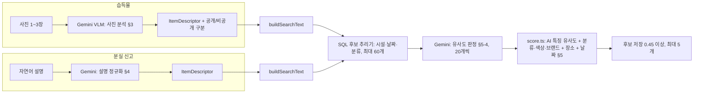

# 05. AI 추출·매칭 명세

> 프롬프트와 스키마의 기준 문서. 코드(`lib/ai/prompts.ts`, `lib/validation/`)를 바꾸면 이 문서도 고친다.
> 점수·임계값은 **초기값**이다. §7 평가로 조정하고, 바꾸면 날짜와 근거를 §11 변경 기록에 남긴다.

---

## 1. 개요

모델을 학습하지 않는다. 사진과 문장을 **같은 형식의 구조화 데이터**로 바꾼 뒤, SQL로 후보를 줄이고 **파운데이션 모델(Gemini)이 후보와 직접 비교**한다 (Stage 1). 임베딩 검색은 데이터가 쌓인 뒤 Stage 2에서 붙인다 (§10, ADR-023).



AI 호출은 다섯 종류다.

| 호출 | 시점 | 모델 | 사용자가 기다리나 |
|---|---|---|---|
| 사진 분석 (VLM) | 관리자 등록 화면 | `VISION_MODEL` (기본 `gemini-4-hydrogen`) | 예 → p95 8초 목표 |
| 설명 정규화 | 신고 저장 후 백그라운드 | `LLM_MODEL` (기본 `gemini-4-hydrogen`) | 아니오 |
| 유사도 판정 | 신고·습득물 저장 후 백그라운드 (후보 20개씩) | `LLM_MODEL` | 아니오 |
| 소유권 답변 비교 | 확인 요청 제출 후 백그라운드 | `LLM_MODEL` | 아니오 (관리자가 A-06에서 봄) |
| 분실자 사진 특징 추출 | 분실자가 사진을 올렸을 때 백그라운드 | `VISION_MODEL` | 아니오 |

임베딩(`gemini-embedding-2`)은 Stage 2에서 추가한다 (§10). 호출 규칙은 §8.

## 2. 공통 스키마

### 2-1. 분류 코드

대분류는 `.` 앞부분이다. 대분류가 같으면 "비슷한 분류"로 본다.

| 코드 | 표시 이름 | 비고 |
|---|---|---|
| `electronics.phone` | 휴대폰 | |
| `electronics.earphones` | 이어폰·헤드폰 | |
| `electronics.charger` | 충전기·케이블·보조배터리 | |
| `electronics.laptop_tablet` | 노트북·태블릿 | |
| `electronics.watch` | 스마트워치 | |
| `electronics.other` | 기타 전자기기 | |
| `wallet_card.wallet` | 지갑 | |
| `wallet_card.card` | 카드·교통카드 | 민감 |
| `wallet_card.id` | 신분증·학생증 | 민감 |
| `bag.bag` | 가방·파우치 | |
| `clothing.outer` | 외투 | |
| `clothing.gloves` | 장갑 | |
| `clothing.hat` | 모자·비니 | |
| `clothing.scarf` | 목도리·넥워머 | |
| `clothing.other` | 기타 의류 | |
| `sports.goggles` | 고글 | |
| `sports.helmet` | 헬멧 | |
| `sports.gear` | 스키·보드 장비 | |
| `accessory.glasses` | 안경·선글라스 | |
| `accessory.jewelry` | 액세서리·주얼리 | |
| `accessory.watch` | 손목시계 | |
| `key.key` | 열쇠·차키 | |
| `umbrella.umbrella` | 우산 | |
| `document.document` | 서류·책 | |
| `other.other` | 기타 | |

### 2-2. 표준 색상

`검정, 흰색, 회색, 은색, 금색, 빨강, 주황, 노랑, 초록, 파랑, 남색, 하늘색, 보라, 분홍, 갈색, 베이지, 투명, 여러 색`

### 2-3. zod 스키마 (`lib/validation/ai.ts`)

```ts
import { z } from 'zod';
import { CATEGORY_CODES, COLORS } from './constants';

// 습득물·신고 공통
export const ItemDescriptor = z.object({
  category: z.enum(CATEGORY_CODES),
  subcategory: z.string().nullable(),   // "무선 이어폰", "스키 고글"
  colors: z.array(z.enum(COLORS)),      // 많아야 3개 (후처리에서 자름)
  brand: z.string().nullable(),         // 확실할 때만
  material: z.string().nullable(),
  features: z.array(z.string()),        // 관찰 가능한 특징
  confidence: z.number(),               // 0~1, 분류 확신도
});

// 사진 분석 결과
export const FoundItemExtraction = ItemDescriptor.extend({
  public_summary: z.string(),           // 분실자에게 보여도 되는 한 문장
  private_features: z.array(z.string()),// 주인만 알 법한 식별 특징
  is_sensitive: z.boolean(),
});

// 설명 정규화 결과
export const LostReportNormalization = ItemDescriptor.extend({
  language: z.string(),                 // 원문 언어 코드 (ko, en, ja, zh ...)
});
```

- Gemini 구조화 출력(`responseJsonSchema`)이 지원하지 않는 스키마 제약이 있을 수 있으므로, **모델에 넘기는 스키마는 단순하게** 두고 개수·범위 검증(색상 3개 이하, features 8개 이하, confidence 0~1)은 파싱 후 코드에서 한다.
- `features`(공개)와 `private_features`(비공개)의 구분이 이 서비스의 핵심 안전장치다.

### 2-4. 비교용 텍스트 (`buildSearchText`)

LLM이 자유롭게 쓴 문장이 아니라 **코드가 같은 틀로 만든 텍스트**를 AI 유사도 판정(§5-4)과 관리자 키워드 검색에 쓴다. 습득물과 신고가 같은 형식이어야 비교가 안정적이다. Stage 2에서는 이 텍스트를 그대로 임베딩한다.

```ts
export function buildSearchText(d: ItemDescriptor, extra: string[] = []): string {
  const features = [...d.features, ...extra];
  return [
    `분류: ${CATEGORY_LABEL[d.category]}${d.subcategory ? ` / ${d.subcategory}` : ''}`,
    d.colors.length ? `색상: ${d.colors.join(', ')}` : null,
    d.brand ? `브랜드: ${d.brand}` : null,
    d.material ? `재질: ${d.material}` : null,
    features.length ? `특징: ${features.join(', ')}` : null,
  ].filter(Boolean).join('\n');
}
```

- 습득물: `extra = private_features` (비공개 특징도 넣는다. 이 텍스트는 서버 안에서 AI 판정에만 쓰고 분실자에게 보내지 않는다).
- 신고: 정규화 입력에 `secret_detail`을 함께 넣으므로 별도 `extra` 없음.

## 3. 습득물 사진 분석

### 3-1. 호출

- 입력: 이미지 1~3장 (base64 JPEG, 긴 변 1280px) + 텍스트 `시설 종류: {facility.type} / 습득 구역: {found_area 또는 "미입력"}`
- 출력: `FoundItemExtraction` (구조화 출력 `responseJsonSchema`)
- 설정: `responseMimeType: "application/json"`, `responseJsonSchema`, 낮은 `thinkingLevel`부터 (값 이름은 SDK 문서 확인), 요청 timeout 15초, 재시도 1회. `temperature`는 보내지 않는다 (§8).
- 화면: 10초가 지나면 "직접 입력하기" 버튼을 함께 보여준다 (응답이 오면 그때 채움).

### 3-2. 시스템 프롬프트 (v1)

```text
너는 분실물 보관소 직원을 돕는 도우미야. 사진 속 물건 하나를 보고 습득물 등록 양식을 채워.

규칙
1. 사진에서 실제로 보이는 것만 적어. 보이지 않는 내용은 추측하지 마.
2. 브랜드는 로고나 글자가 보일 때만 적어. 모양만 보고 짐작했다면 brand는 null로 두고,
   features에 "OO과 비슷한 모양"이라고 적어.
3. category는 주어진 목록에서 골라. 애매하면 가장 가까운 것을 고르고 confidence를 낮춰.
4. 특징을 공개용과 비공개용으로 나눠.
   - public_summary: 분실자에게 보여줘도 되는 한 문장. 분류, 색상, 크기 정도만.
     예) "검은색 무선 이어폰 케이스"
   - features: 여러 사람이 가진 물건에도 있을 법한 일반 특징.
     예) "무광 재질", "케이스형"
   - private_features: 주인만 알 법한 식별 특징. 스티커, 키링, 이니셜, 흠집, 무늬, 안에 든 물건.
     예) "은색 별 모양 키링", "뒷면 왼쪽 아래 긁힘", "지갑 안 교통카드 1장"
   public_summary와 features에는 private_features의 내용을 넣지 마.
5. 신분증, 학생증, 신용카드, 여권, 운전면허증이 보이면 is_sensitive를 true로 해.
   이름, 생년월일, 카드번호, 학번, 주소 같은 개인정보는 어떤 필드에도 적지 마.
   "학생증 (이름 가림)"처럼 써.
6. 사진에 물건이 여러 개면 가장 크고 가운데 있는 물건 하나만 기록하고,
   features에 "함께 찍힌 물건: ..."을 적어.
7. 모든 텍스트는 한국어로 써.

분류 목록: {CATEGORY_CODES와 표시 이름}
색상 목록: {COLORS}
```

### 3-3. 후처리

1. zod 파싱. 실패하면 1회 재시도, 다시 실패하면 `extraction: null` (수동 입력).
2. `colors` 3개, `features`·`private_features` 각 8개로 자른다.
3. `category`가 `wallet_card.card` 또는 `wallet_card.id`면 `is_sensitive = true`로 강제.
4. 개인정보 패턴 마스킹 (안전망): 숫자 6자리 이상 연속, 이메일, 전화번호 형식 → `***`.
5. `ai_raw`에 원본 응답과 `usageMetadata` 저장, `ai_latency_ms` 기록.

## 4. 분실 설명 정규화

### 4-1. 호출

- 입력: `설명: {description}` + (있으면) `추가 특징: {secret_detail}` + (있으면) `분실자가 고른 분류: {user_category}`
- **연락처, 이름은 넣지 않는다.**
- 출력: `LostReportNormalization`
- 설정: 구조화 출력(`responseJsonSchema`), 낮은 `thinkingLevel`

### 4-2. 시스템 프롬프트 (v1)

```text
너는 분실 신고 문장을 분실물 검색용 정보로 정리해.

규칙
1. 신고자가 쓴 내용만 옮겨. 쓰지 않은 색상, 브랜드, 특징을 지어내지 마.
2. category는 목록에서 골라. "분실자가 고른 분류"가 있으면 그것을 우선해.
3. 색상은 표준 색상 목록으로 바꿔. 예) "곤색" → "남색", "실버" → "은색", "아이보리" → "베이지"
4. 제품 별칭은 표준 이름으로 바꿔. 예) "에어팟" → brand "Apple", subcategory "무선 이어폰"
5. 여러 물건을 잃어버렸다고 쓰면 첫 번째 물건만 정리하고,
   features에 "함께 잃어버린 물건: ..."을 적어.
6. 장소, 시간, 연락처는 정리하지 마. 다른 칸에서 따로 받아.
7. 외국어로 쓰였으면 한국어로 옮겨서 정리하고, language에 원래 언어 코드를 적어.
8. 정보가 너무 적으면 category는 "other.other", confidence는 0.3 이하로 해.

분류 목록: {CATEGORY_CODES와 표시 이름}
색상 목록: {COLORS}
```

### 4-3. 실패 처리

정규화가 실패하면 `ai_status = 'failed'`, `category = user_category`, `search_text = description` 원문 그대로 AI 유사도 판정(§5-4)에 넣고 매칭을 계속한다.

### 4-4. 분실자가 올린 사진 (선택)

- 여행 사진처럼 물건이 나온 사진을 올리면 §3과 같은 추출을 돌린다. 프롬프트에 "사진 속 사람은 무시하고, 잃어버린 물건(분류: {user_category})만 기록해"를 더한다.
- 뽑은 `features`, `colors`, `brand`를 정규화 결과와 합친다. 글로 쓴 내용과 다르면 글을 우선한다.
- 이 사진은 매칭과 관리자 확인의 **보조 근거**다. 사진에 나왔다는 것만으로 반환하지 않는다 (`01-prd.md` F7-10).

### 4-5. "잘 모르겠어요" 처리

- 분실자가 모른다고 고른 색상·브랜드·구역·시간대는 `null` 또는 빈 배열로 저장한다. 정규화 프롬프트는 이 값을 지어내지 않는다.
- `null`은 "틀림"이 아니라 "모름"이다. 점수에서는 그 신호를 빼고 계산한다 (§5-1 동적 가중치).

## 5. 점수 계산 (`lib/matching/score.ts`)

### 5-1. 공식

```
신호별 가중치 (합 1.0)
  AI 특징 유사도  0.42  (= 0.60 × 0.70)   항상 있음 (§5-4 판정값)
  분류    0.09    (= 0.60 × 0.30 × 0.5)
  색상    0.054   (= 0.60 × 0.30 × 0.3)
  브랜드  0.036   (= 0.60 × 0.30 × 0.2)
  장소    0.25
  날짜    0.15                              항상 있음

AI 특징 유사도 = Gemini 판정값 (0, 0.25, 0.5, 0.75, 1 중 하나, §5-4)

알 수 있는 신호 K = 양쪽 값이 모두 있는 신호 ("모름"은 빠짐)
정보 충족도 coverage = Σ(i∈K) w_i                       # 0.57 ~ 1.0
최종 점수 score      = Σ(i∈K) w_i × s_i / coverage       # 모르는 신호는 0점이 아니라 계산에서 빠짐
```

모든 신호가 있으면 이전 공식(0.60 × 특징 + 0.25 × 장소 + 0.15 × 날짜, 특징 = 0.70 × AI 특징 유사도 + 0.30 × 속성)과 같다.

**일치도와 정보 충족도는 따로 본다.** 장소만 맞았다고 주인일 가능성이 높은 게 아니다. coverage가 낮으면 후보로는 보여주되 "정보가 적어요"를 붙이고 알림은 보내지 않는다.

**같은 물건이 여러 개일 때**: 상위 후보끼리 점수 차가 0.05 이내면 `breakdown.tie = true`로 표시하고 모두 보여준다. 하나를 고르지 않는다.

신호별 점수 s_i:

| 항목 | 값 |
|---|---|
| **분류** | 세부 분류 같음 1.0 / 대분류만 같음 0.6 / 다름 0 / 한쪽이 `other.other`나 null이면 "모름"으로 뺀다 |
| **색상** | 자카드 유사도 \|A∩B\| / \|A∪B\|. 한쪽이 비어 있으면 "모름"으로 뺀다 |
| **브랜드** | 둘 다 있고 같음 1.0 / 다름 0 (대소문자·공백 무시) / 한쪽이 null이면 "모름"으로 뺀다 |
| **장소** | 같은 구역 1.0 / 다른 구역 0.5 / (P1) 같은 지역 다른 시설 0.3 / 한쪽이 구역 모름이면 "모름"으로 뺀다 |
| **날짜** | 습득일 d (한국 시간). `lost_from−1 ≤ d ≤ lost_to+1` → 1.0. `d > lost_to+1` → `max(0, 1 − (d − (lost_to+1)) / 14)`. `d < lost_from−1` → 후보 제외 (SQL에서 이미 걸러짐). **시간대 보정**: 분실자가 시간대를 골랐고 같은 날 주웠는데 습득 시각이 그 시간대 시작보다 1시간 넘게 이르면 × 0.3 (잃어버리기 전에 주운 것). 시간대 시작: 오전 06시, 점심 11시, 오후 13시, 저녁 17시 |

**제외 규칙**: 양쪽 분류 confidence가 모두 0.7 이상이고 대분류가 다르며 어느 쪽도 `other`가 아니면 후보에서 뺀다.

**예시** (모든 신호가 있을 때, coverage 1.0): 특징 0.92, 장소 1.0, 날짜 0.8 → 0.6×0.92 + 0.25×1.0 + 0.15×0.8 = **0.922**

**예시 2** (구역·브랜드를 모를 때): AI 특징 유사도 0.75, 분류 1.0, 색상 1.0, 날짜 1.0 → coverage = 0.42+0.09+0.054+0.15 = 0.714, score = (0.42×0.75 + 0.09 + 0.054 + 0.15) / 0.714 ≈ **0.853**. coverage 0.714는 "정보가 적어요" 기준(0.65)보다 높아서 알림 대상이 된다. 색상까지 모르면 coverage 0.66으로 기준에 겨우 걸치고, 분류도 "기타"면 0.57이라 "정보가 적어요"가 붙고 알림을 보내지 않는다.

### 5-2. 임계값

| 이름 | 초기값 | 쓰임 |
|---|---|---|
| `MATCH_SAVE_THRESHOLD` | 0.45 | 이 점수 이상만 후보로 저장 (신고당 최대 5개) |
| `MATCH_NOTIFY_THRESHOLD` | 0.70 | 이 점수 이상 새 후보가 생기면 이메일. 화면 라벨 "유사도 높음" |
| `COVERAGE_MIN_NOTIFY` | 0.65 | 이 충족도 미만이면 알림을 보내지 않고 "정보가 적어요"를 표시한다 |
| `TIE_GAP` | 0.05 | 상위 후보끼리 이 차이 안이면 비슷한 물건 여러 개로 본다 |
| `AI_JUDGE_BATCH`, `AI_JUDGE_MAX_CANDIDATES` | 20, 60 | 한 번에 판정할 후보 수, 신고 1건당 최대 후보 수. 60개를 자주 넘으면 Stage 2 신호 (§10) |

### 5-3. 함수 형태

```ts
export type ScoreInput = {
  aiSimilarity: number;  // §5-4 판정값 (0, 0.25, 0.5, 0.75, 1)
  a: { category: string; colors: string[]; brand: string | null; confidence: number | null };
  b: { category: string; colors: string[]; brand: string | null; confidence: number | null };
  area: { report: string | null; item: string | null };
  date: { lostFrom: string; lostTo: string; found: string; foundTime?: string; lostTimeOfDay?: 'morning' | 'lunch' | 'afternoon' | 'evening' | null };  // 날짜 YYYY-MM-DD, 시각 HH:mm (KST)
};
export type ScoreResult =
  | { excluded: true; reason: 'category_mismatch' | 'date_before_loss' }
  | { excluded: false; score: number; coverage: number; breakdown: { ai: number; category: number | null; color: number | null; brand: number | null; place: number | null; date: number; known: string[] } };

export function scoreCandidate(input: ScoreInput, cfg = DEFAULT_CONFIG): ScoreResult;
```

순수 함수다. DB·네트워크에 접근하지 않는다. 단위 테스트로 §5-1의 표 모든 칸, 예시 1(0.922)과 예시 2, 모르는 신호가 빠질 때의 coverage, 시간대 보정을 검증한다. `tie`는 후보 목록 단위로 `run.ts`에서 정한다.

### 5-4. AI 유사도 판정 (Stage 1)

임베딩 대신 파운데이션 모델이 후보를 직접 비교한다. 먼저 SQL로 후보를 줄여 한 번에 비교할 양을 작게 유지한다.

1. **후보 추리기** (`candidate_items_for_report`, 역방향 `candidate_reports_for_item`, `04-architecture.md` §4-3): 같은 시설, 날짜 창(`lost_from−1` ~ `lost_to+14`), 대분류가 같거나 한쪽이 모름·확신도 낮음. 날짜가 가까운 순으로 최대 60개.
2. **판정**: 20개씩 묶어 Gemini에 보낸다 (최대 3번, 병렬). 입력은 기준 쪽(신고 또는 습득물)의 `buildSearchText`와 원문, 후보마다 짧은 번호(C1, C2 …)와 `buildSearchText`. 습득물의 비공개 특징도 넣는다 (서버 안에서만 쓴다). **연락처는 넣지 않는다.**
3. **출력** (`lib/validation/ai.ts`):

```ts
export const SimilarityJudgement = z.object({
  results: z.array(z.object({
    id: z.string(),                 // C1, C2 … (코드에서 실제 id로 바꾼다)
    similarity: z.number(),         // 0, 0.25, 0.5, 0.75, 1 중 하나 (후처리에서 가장 가까운 값으로 맞춤)
    matched: z.array(z.string()),   // 맞는 특징 (관리자 전용)
    conflicts: z.array(z.string()), // 서로 다른 특징 (관리자 전용)
  })),
});
```

4. **점수**: `similarity`가 §5-1의 "AI 특징 유사도"가 된다. 분류·색상·브랜드·장소·날짜는 지금처럼 코드 규칙으로 계산한다. `matched`, `conflicts`는 `breakdown`에 저장해 A-05·A-06에서 관리자에게 "왜 비슷한지"로 보여준다. 분실자에게는 보내지 않는다.

시스템 프롬프트 (v1)

```text
너는 분실물 보관소의 매칭 도우미야. 기준 물건 하나와 후보 물건 목록을 비교해서, 같은 물건일 가능성을 후보마다 매겨.

척도 (이 다섯 값만 쓴다)
- 1    : 고유한 특징(스티커, 키링, 각인, 흠집, 안에 든 것)까지 맞고 서로 다른 점이 없다
- 0.75 : 종류·색·브랜드 같은 주요 특징이 맞고 서로 다른 점이 없다
- 0.5  : 종류는 같고 일부만 맞거나, 비교할 정보가 적다
- 0.25 : 종류만 비슷하고 특징은 거의 맞지 않는다
- 0    : 분명히 다른 물건이다 (서로 다른 특징이 있다)

규칙
1. 주어진 정보만 비교한다. 없는 정보는 추측하지 않고, 정보가 없다는 이유로 점수를 깎지도 않는다.
2. 표현이 달라도 뜻이 같으면 같은 특징이다. 예) "곤색" = "남색", "에어팟" = "Apple 무선 이어폰"
3. 후보끼리 비교하지 말고, 각 후보를 기준 물건과만 비교한다.
4. matched와 conflicts에는 근거가 된 특징만 짧게 적는다. 이름·번호 같은 개인정보는 쓰지 않는다.
5. 목록의 모든 후보에 대해 결과를 하나씩 낸다.
```

- `temperature`를 쓸 수 없으므로(§8) 척도를 다섯 값으로 고정해 흔들림을 줄이고, 같은 입력을 두 번 판정했을 때 값이 바뀌는지 §7에서 잰다.
- 판정이 실패한 묶음은 `similarity = 0.5`(중립)로 두고 실패를 기록한다. 규칙 점수로 후보를 저장하되 알림은 보내지 않는다.

## 6. 실행 계기와 저장 규칙

| 계기 | 실행 | 비고 |
|---|---|---|
| 신고 저장 | 정규화 → `candidate_items_for_report` → AI 유사도 판정 → 점수 → 저장 → 알림 | `after()` |
| 습득물 저장 | `candidate_reports_for_item` → AI 유사도 판정 → 점수 → 저장 → 알림 | `after()` |
| 습득물 수정 (분류·색상·브랜드·특징) | 역방향 매칭 다시 실행 | 기존 `suggested` 후보는 점수만 갱신 |
| 관리자 "다시 분석" | `ai_status = failed`인 것 재처리 | |

저장 규칙
- `(lost_report_id, found_item_id)` 기준 upsert. 두 번 실행돼도 결과가 같아야 한다.
- 상태가 `suggested`인 후보만 점수를 갱신한다. `claimed` 이후는 건드리지 않는다.
- 분실자가 `dismissed`한 후보는 다시 만들지 않는다.
- 신고당 `suggested` 후보는 점수 상위 5개만 유지한다.
- 새로 0.70을 넘고 coverage가 0.65 이상인 후보만 알림 대상이다 (`notified_at is null`).
- 같은 `contact_key`의 다른 신고가 같은 습득물로 이미 알림을 받았으면 다시 보내지 않는다 (`02-user-flows.md` §7-1).
- 여러 시설에 한 번에 신고하면(P1) 시설마다 신고가 따로 있으므로 매칭도 시설마다 따로 한다. 다른 시설의 습득물과는 비교하지 않는다.

## 7. 평가

### 7-1. 데이터 모으기 (Day 2~3)

1. **실제 물건 30~50개**를 팀원·지인에게서 모은다.
2. 물건 주인은 맡기기 **전에** 사진을 보지 않고 기억대로 60초 안에 설명을 쓴다 (실제 분실자처럼).
3. 다른 사람이 관리자 역할로 A-03에서 등록한다.
4. **비슷한 물건 묶음**을 일부러 넣는다: 검은 무선 이어폰 3개, 검은 장갑 2켤레, 흰 충전기 3개, 비슷한 카드지갑 2개 이상.
5. **미끼 신고 10건**: 등록하지 않은 물건의 설명. 후보가 높게 나오면 안 된다.
6. **중복 신고 3쌍**: 같은 사람이 같은 물건을 표현만 바꿔 두 번 신고한다. 두 신고 모두 같은 정답을 찾아야 하고, 알림은 1통이어야 한다.
7. 분실 날짜·구역은 실제 사람처럼 가끔 하루 틀리거나 "잘 모르겠어요"로 둔다.
8. 정답 표: 습득물마다 실제 분류와 색상을 사람이 적는다 (추출 정확도 측정용).
9. **기억이 흐린 신고 10건**: 분류·구역·날짜만 넣고 설명은 비운 신고. coverage가 낮게 나와야 하고, 정답이 후보 안에 있는지 따로 잰다.
10. **판정 안정성**: 같은 신고를 두 번 판정해 유사도 값이 바뀐 후보의 비율을 잰다.

### 7-2. 파일 형식 (`eval/cases.json`)

```json
{
  "items": [
    {
      "key": "I01",
      "photos": ["eval/photos/I01-1.jpg"],
      "found_at": "2026-11-27T10:20:00+09:00",
      "found_area": "3층 강의실",
      "truth": { "category": "electronics.earphones", "colors": ["검정"] }
    }
  ],
  "reports": [
    {
      "key": "R01",
      "description": "검은색 무선 이어폰인데 케이스에 은색 키링이 달려 있어요",
      "secret_detail": "케이스 안쪽에 고양이 스티커",
      "lost_from": "2026-11-27",
      "lost_to": "2026-11-27",
      "lost_area": "3층 강의실",
      "expected_item": "I01",
      "split": "dev"
    },
    {
      "key": "R41",
      "description": "남색 장지갑, 지퍼 고장남",
      "lost_from": "2026-11-26",
      "lost_to": "2026-11-27",
      "lost_area": null,
      "expected_item": null,
      "split": "test"
    }
  ]
}
```

### 7-3. 실행 (`pnpm eval`)

1. 평가 전용 시설(`slug = eval-YYYYMMDD`)을 만든다. 운영 데이터와 섞지 않는다.
2. 습득물을 모두 등록(실제 사진 분석 호출) → 신고를 모두 넣고 매칭.
3. 지표를 계산해 `eval/results/YYYY-MM-DD.md`에 저장하고 터미널에 표로 출력한다.
4. 평가 시설을 지운다 (`--keep` 옵션이면 남김).

### 7-4. 지표

| 지표 | 정의 | 목표 |
|---|---|---|
| Top-1 정확도 | 정답이 1위인 신고 비율 | 참고 |
| **Top-3 재현율** | 정답이 3위 안에 있는 신고 비율 (정답 있는 신고만) | 90% 이상 |
| 흐린 신고 Top-3 재현율 | 정보가 적은 신고 중 정답이 3위 안에 있는 비율 | 70% 이상 |
| 판정 안정성 | 같은 입력을 두 번 판정했을 때 값이 같은 후보 비율 | 90% 이상 |
| MRR | 정답 순위 역수의 평균 | 참고 |
| **오알림률** | 미끼 신고 중 0.70 이상 후보가 생긴 비율 | 10% 이하 |
| 잘못된 1위 알림 | 정답 있는 신고에서 1위가 오답인데 0.70 이상인 비율 | 낮을수록 좋음 |
| 분류 정확도 | 사진 분석 분류 = 정답 분류 | 90% 이상 |
| 색상 정확도 | 정답 색상이 추출 색상에 포함 | 참고 |
| 사진 분석 지연 | p50, p95 | p95 8초 이하 |
| 건당 비용 | `usage` 토큰 × 단가 | 기록 |

### 7-5. 과적합 막기

- 신고를 `dev`와 `test` 반반으로 나눈다.
- 가중치·임계값·프롬프트는 `dev` 결과만 보고 고친다.
- 발표에는 `test` 결과를 쓴다.
- 표본이 작으므로 숫자와 함께 표본 수를 반드시 적는다: "Top-3 재현율 93% (test 신고 15건, 2026-11-27 팀 자체 평가)".

## 8. Gemini API 호출 규칙

확인일 2026-11-25 (Google AI for Developers 문서). 모델과 SDK는 자주 바뀌니 구현 전에 문서를 다시 확인한다.

- SDK: `@google/genai` (`import { GoogleGenAI } from "@google/genai"`). 예전 패키지 `@google/generative-ai`는 쓰지 않는다. 클라이언트는 `lib/ai/client.ts`에 하나, 키는 `GEMINI_API_KEY`.
- 호출: `ai.models.generateContent({ model, contents, config })`. 이미지는 `{ inlineData: { mimeType: "image/jpeg", data: base64 } }` 파트로 넣는다 (요청 전체 20MB 미만).
- 구조화 출력: `config: { responseMimeType: "application/json", responseJsonSchema: z.toJSONSchema(Schema) }`. 받은 JSON은 다시 zod로 검증한다.
- `temperature`, `topP`, `topK`는 보내지 않는다. Gemini 4와 3.6 이상은 이 값을 무시하고, 앞으로 400 에러를 낼 예정이다.
- 생각 깊이: `thinkingConfig.thinkingLevel`. 추출·판정은 낮은 단계부터 시작해 평가로 올린다 (값 이름은 SDK 문서 확인).
- 응답이 비었거나 정상 종료가 아니면(`finishReason`이 `STOP`이 아님, 차단 등) 실패로 보고 1회 재시도한다. 그래도 실패하면 §3-3, §4-3, §5-4의 실패 처리로 넘어간다.
- 모델은 환경변수(`VISION_MODEL`, `LLM_MODEL`). 기본은 `gemini-4-hydrogen`(문서 예제의 기본 모델, 무료 등급 있음). 대안은 Stable 표시가 확인된 `gemini-3.8-flash`, 저비용 `gemini-3.5-flash-lite`. `gemini-2.5-flash`는 2026-12-01 종료 예정이라 쓰지 않는다 (ADR-024).
- 문서는 새 Interactions API를 기본으로 안내하고 `generateContent`를 이전 API로 표시한다. MVP는 단발 호출이라 `generateContent`로 시작하되, 구현할 때 지원 상태를 확인한다 (Q17).
- **데이터 정책**: 무료 등급 입력은 구글 제품 개선에 쓰이고 사람이 볼 수 있다. 무료 등급 키(`GEMINI_TIER=free`)로는 팀이 만든 테스트 데이터만 보낸다. 실제 분실자 정보·사진은 결제가 연결된 유료 등급 키로만 처리한다 (ADR-025).
- 매 호출마다 `{ kind, model, latency_ms, usageMetadata, finish_reason }`을 로그로 남긴다. 연락처·토큰은 남기지 않는다.

## 9. 소유권 확인 보조

원칙: 매칭은 "비슷한 물건"을 찾고, 소유권 확인은 따로 한다. AI는 답변을 비교해 관리자를 도울 뿐 승인하지 않는다 (ADR-007, ADR-019).

### 9-1. 분류별 확인 질문 (고정)

질문은 **분류에만** 따라 정해진다. 같은 분류의 모든 습득물에 똑같은 질문이 나가므로, 질문만 보고 이 물건에 각인이 있는지 같은 비공개 정보를 알 수 없다. 모두 주관식이다. 문구는 `messages/ko.json`에 둔다.

| 분류 | 질문 (2~3개) | 수령 시 추가 증빙 |
|---|---|---|
| `electronics.phone`, `laptop_tablet`, `watch` | 화면·케이스에 다른 것과 구별되는 특징 / 케이스나 뒷면에 붙어 있던 것 / 마지막으로 쓴 곳과 시간 | 잠금 해제 또는 일련번호 (필수) |
| `electronics.earphones`, `charger`, `other` | 겉모습의 특징(흠집, 색 바램 등) / 케이스에 붙어 있거나 달려 있던 것 / 마지막으로 쓴 곳과 시간 | 고가 이어폰은 일련번호 권장 |
| `wallet_card.*` | 안에 들어 있던 것 / 겉모습의 특징 / 마지막으로 쓴 곳과 시간 | 신분증 대조 (필수) |
| `bag.bag` | 안에 들어 있던 것 / 달려 있던 것(키링 등) / 손상되거나 낡은 부분 | — |
| `clothing.*`, `sports.*` | 브랜드나 크기 / 라벨·이름표·각인 같은 표시 / 흠집이나 손상 | — |
| `accessory.*`, `key.key`, `umbrella.umbrella`, `document.document`, `other.other` | 겉모습의 특징 / 붙어 있거나 달려 있던 것 / 마지막으로 쓴 곳과 시간 | — |

물건마다 AI가 질문을 새로 만드는 방식은 쓰지 않는다. 비공개 특징을 보고 만든 질문은 그 특징이 있다는 사실을 드러내기 쉽다 (예: "각인이 있나요?"). 이 방식을 특허 관점에서 검토하려면 질문이 정보를 흘리지 않는다는 조건을 함께 검토한다 (ADR-019).

### 9-2. 답변 비교 호출

- 입력: 확인 질문과 답변, 신고 원문과 `secret_detail`, 습득물의 분류·공개 설명·`private_features`·습득 구역·날짜. **연락처는 넣지 않는다.**
- 출력 (구조화 출력 `responseJsonSchema`, `lib/validation/ai.ts`):

```ts
export const OwnershipVerdict = z.object({
  items: z.array(z.object({
    key: z.enum(['appearance', 'marks', 'contents', 'place_time', 'serial']),
    result: z.enum(['match', 'mismatch', 'unknown']),
    note: z.string(),          // 관리자용 한 줄 근거
  })),
  insufficient: z.boolean(),   // 흔한 물건이라 판단 근거가 부족한가
  summary: z.string(),         // 관리자용 한 줄 의견. "승인하세요" 같은 결론은 쓰지 않는다
});
```

- 분류처럼 이미 공개된 정보는 비교 항목에서 뺀다. 공개 정보가 맞는 건 주인이라는 근거가 되지 않는다.
- 설정: 낮은 `thinkingLevel`, 응답 뒤 백그라운드(`after()`). 실패하면 `ai_verdict = null`로 두고 관리자가 직접 비교한다.

### 9-3. 시스템 프롬프트 (v1)

```text
너는 분실물 보관소 관리자를 돕는 검토 보조야. 분실자의 답변이 보관 중인 물건의 비공개 특징과 맞는지 항목별로 비교해.

규칙
1. 판단은 관리자가 한다. "승인", "반환" 같은 결론을 쓰지 말고 비교 결과만 적어.
2. 의미가 같으면 표현이 달라도 일치로 본다. 예) "은색 별 키링" = "별 모양 은색 고리"
3. 답변이 너무 일반적이면(예: "검은색이에요", "평범해요") 일치로 보지 말고 unknown으로 해.
4. 답변에 없는 내용은 unknown이다. 추측으로 채우지 마.
5. 비공개 특징과 분명히 다르면 mismatch다.
6. 물건에 구별되는 비공개 특징이 거의 없으면 insufficient를 true로 해.
7. 이름, 번호 같은 개인정보는 note와 summary에 다시 쓰지 마.
```

### 9-4. 시도 제한과 노출 규칙

- 한 신고에서 진행 중인 확인 요청은 1건 (DB 고유 인덱스).
- 같은 신고·습득물 쌍은 최대 2번 요청 (`claim_attempt`).
- 같은 `contact_key`로 7일 안에 서로 다른 습득물 3건 이상을 요청하면 A-06에 경고.
- `ai_verdict`는 분실자 응답, 이메일, 거절 안내에 절대 넣지 않는다. 결과를 보여주면 여러 번 시도하며 답을 맞출 수 있다.

### 9-5. 평가

- 진짜 주인: 평가 물건의 주인이 직접 확인 질문에 답한다. 비공개 항목(appearance, marks, contents, serial) 중 1개 이상 `match`이고 `mismatch`가 없으면 통과. 목표 80% 이상.
- 가짜 요청: 다른 팀원이 공개 정보(분류, 공개 설명, 구역)만 보고 남의 물건에 답한다. 비공개 항목에 `match`가 없으면 걸러낸 것. 목표 90% 이상, 10건 이상.
- 결과는 `pnpm eval` 결과 파일에 함께 남긴다.

## 10. 발전 단계 (Stage 1 → 3)

| 단계 | 언제 | 매칭 방식 | 바뀌는 것 |
|---|---|---|---|
| **Stage 1 (MVP)** | 지금 | SQL 후보 추리기(시설·날짜·분류) → Gemini가 후보와 직접 비교(§5-4) → 규칙 점수 | 모델 학습·벡터 DB 없음. 판정 이유(`matched`, `conflicts`)를 관리자에게 보여줄 수 있다 |
| **Stage 2 (임베딩 검색)** | 후보가 60개를 자주 넘을 때, 의미 검색이나 시설 간 검색이 필요할 때 | `gemini-embedding-2`(768차원, 텍스트·이미지)로 `search_text`와 사진을 벡터로 저장 → pgvector에서 상위 30개 → Stage 1 판정으로 재순위 | `vector(768)` 컬럼 마이그레이션, 기존 데이터 일괄 임베딩. 분실자 여행 사진과 습득물 사진을 이미지끼리 비교할 수 있다 |
| **Stage 3 (파이프라인)** | 여러 시설과 여러 단계(검색 → 재순위 → 소유권 확인 → 문의 응답)가 붙을 때 | LangChain(JS)이나 LangGraph로 검색·재순위·평가 흐름을 묶는다 | 문의 응답 챗봇, 시설 간 통합 탐색, 평가 자동화. 패키지와 구성은 이때 확인한다 |

- 임베딩은 LangChain 없이 SDK(`ai.models.embedContent`)로 바로 쓸 수 있다. LangChain은 여러 단계를 묶을 때 고려한다.
- `gemini-embedding-2`는 `taskType`을 받지 않는다. 작업을 텍스트 앞에 적는다 (예: 질의 `task: search result | query: ...`, 문서 `title: ... | text: ...`). 768처럼 줄인 차원도 자동 정규화된다. 텍스트 전용 `gemini-embedding-001`은 2028-05-14 종료 예정이라 새로 쓰지 않는다.
- Stage 2로 넘어가는 신호: 후보가 60개를 넘는 신고가 10% 이상, 판정 비용·지연이 목표를 넘음, 시설 간 검색 요구.

## 11. 변경 기록

| 날짜 | 변경 | 근거 |
|---|---|---|
| 2026-11-25 | v1 초안 (가중치 60/25/15, 임계값 0.45/0.70) | 사업계획서 초기 설계 |
| 2026-11-25 | §9 소유권 확인 보조 추가 (분류별 고정 질문, 답변 비교, 시도 제한) | 발표·피드백 질문 "진짜 주인인지 어떻게 아나" |
| 2026-11-25 | §5 동적 가중치와 정보 충족도(coverage), 시간대 보정, tie. §4-4 분실자 사진, §4-5 "모름" 처리 | 기억이 흐린 분실자, 같은 물건 여러 개 대응 (ADR-020) |
| 2026-11-25 | AI 제공자를 Gemini로 변경. 임베딩 대신 SQL 후보 추리기 + Gemini 유사도 판정(§5-4), "벡터" 신호를 "AI 특징 유사도"로. 발전 단계 §10 | ADR-023, ADR-024 |
